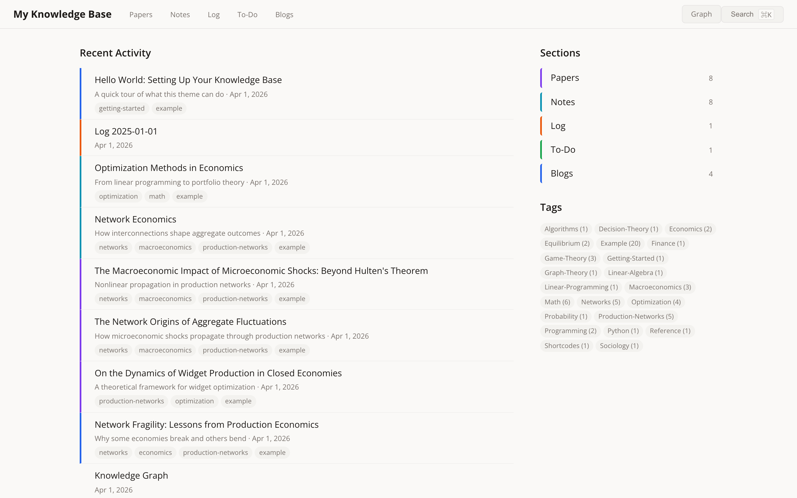
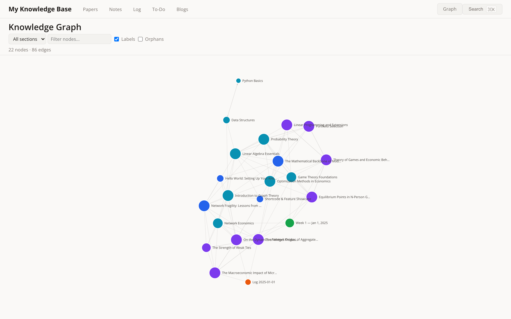
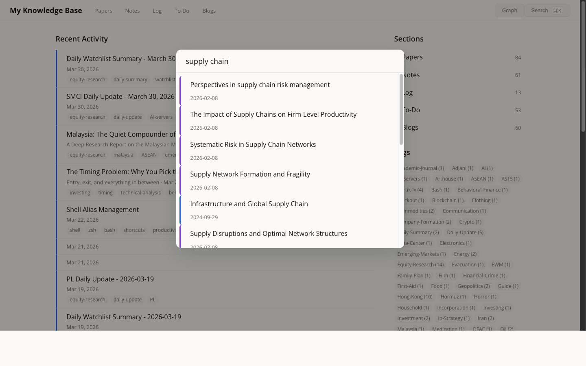
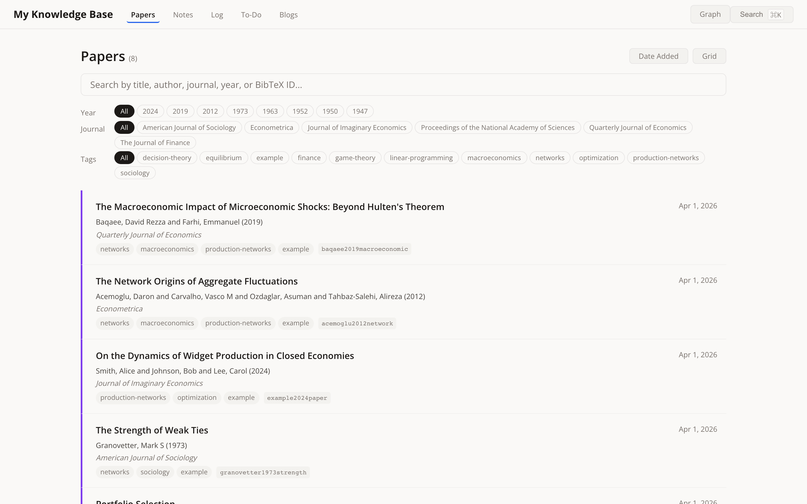
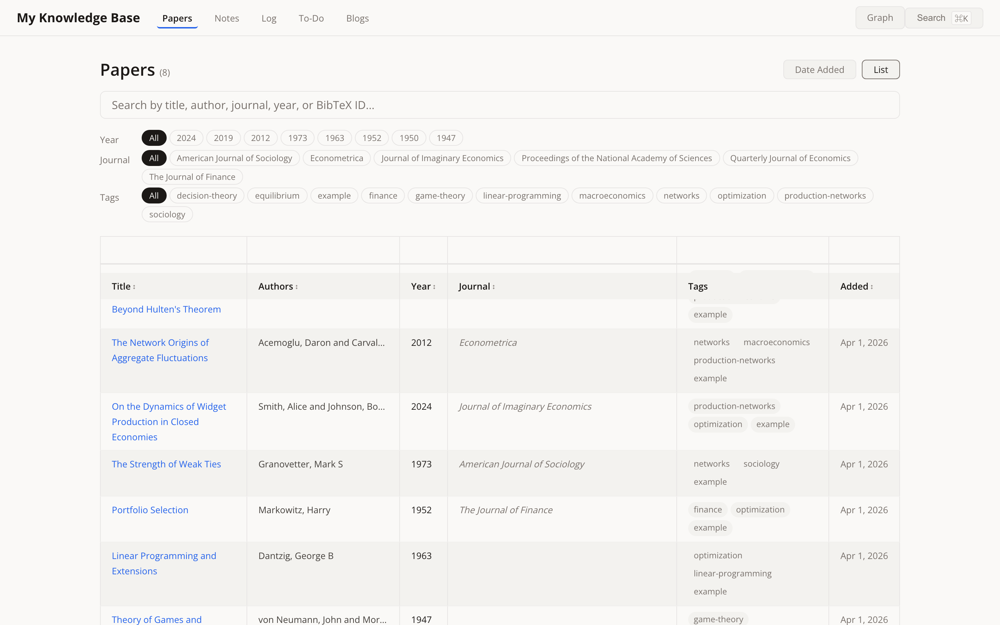
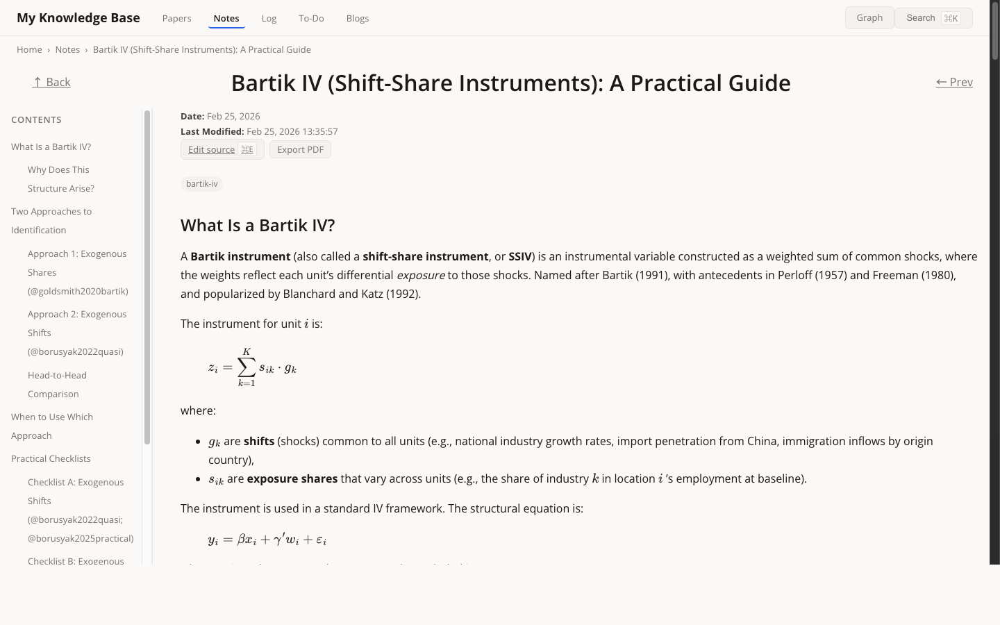
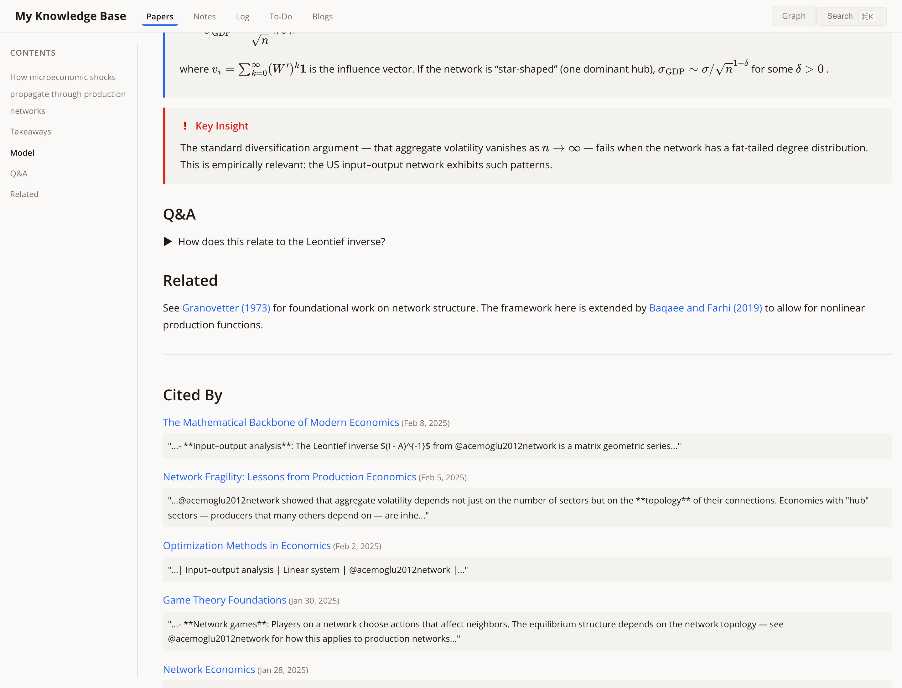
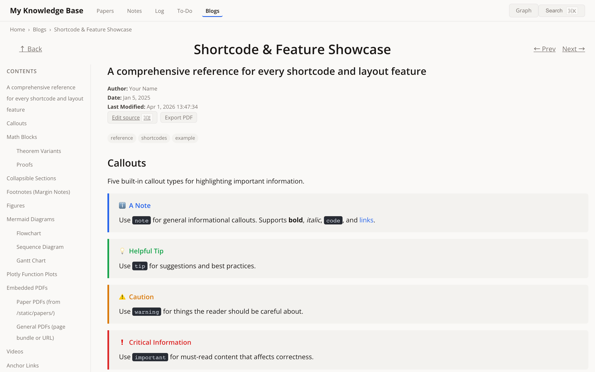
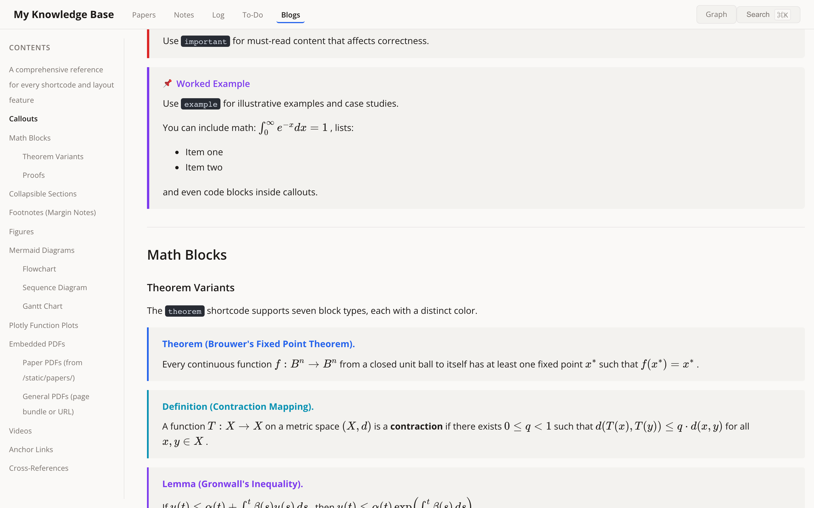
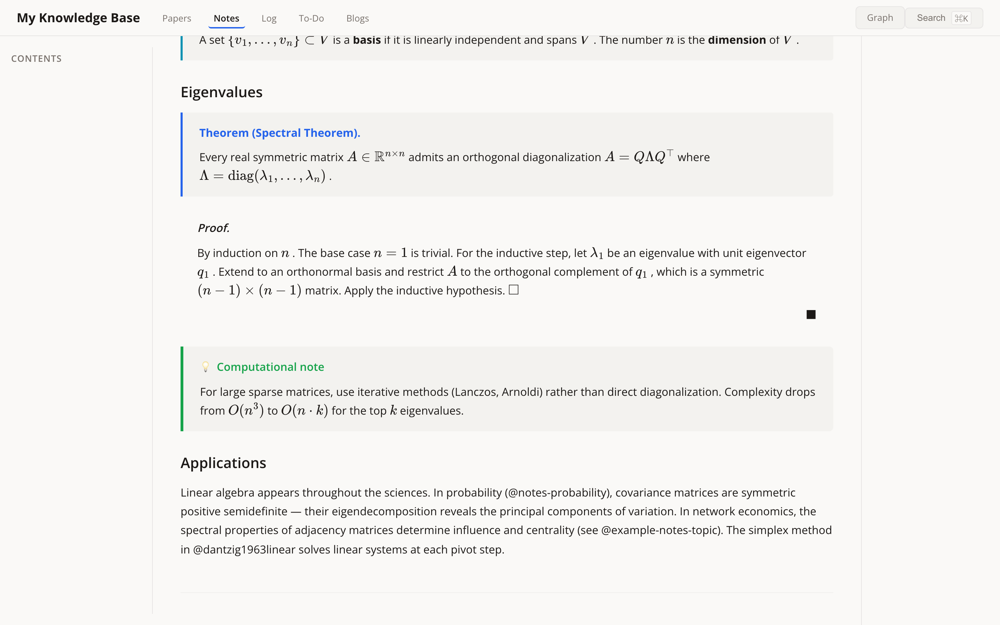

# Knowledge Base Theme for Hugo

A Hugo theme for academic knowledge management — papers, notes, blogs, and daily logs — with a bidirectional citation system, interactive knowledge graph, full-text fuzzy search, and rich shortcodes for math, diagrams, and more.


## Screenshots

**Homepage** — dashboard with recent activity, section links, and tag cloud:



**Knowledge Graph** — interactive D3.js force-directed graph of citation relationships across all content:



**Full-text Search** — fuzzy search overlay (`⌘K`) with content snippets and tag pills:



**Papers list** — search, filter by year/journal/tag, multiple sort modes:



**Papers table** — sortable columns for title, authors, year, journal, tags:



**Paper page** — three-column layout with TOC, rendered math, and margin notes:



**Citations & backlinks** — inline APA-formatted citations, auto-generated References, and "Cited By" backlinks with context snippets:



**Callouts** — five styled callout types (note, tip, warning, important, example):



**Math blocks** — theorem, definition, lemma, proposition, corollary with rendered LaTeX:



**Stacked layout** — nested notes rendered inline on one page:



## Features

- **Interactive knowledge graph**: D3.js force-directed graph visualizing citation relationships across all content. Nodes colored by section type, sized by connection count. Filter by section, search, toggle labels and orphans.
- **Full-text fuzzy search**: Press `⌘K` to open the search overlay. Powered by Fuse.js with weighted matching across title, tags, content, and citation IDs. Results include content snippets and tag pills.
- **Bidirectional citations**: Type `@pageID` to cite any page. Auto-formatted in APA style with a generated References section. Cited pages show "Cited By" backlinks with context snippets.
- **BibTeX support**: Store BibTeX entries in front matter. Export `.bib` files for your manuscripts with the included script.
- **Papers dashboard**: Dedicated papers section with search, filtering by year/journal/tag, five sort modes, and three view modes (List, Grid, Table).
- **Summary transclusion**: Embed abstracts from other pages inline with ``.
- **Math rendering**: MathJax with common macros (configurable). Supports inline `$...$` and display `$$...$$` math.
- **Rich shortcodes**: Theorems, proofs, callouts, collapsible sections, Plotly charts, Mermaid diagrams, figures, PDFs, and videos.
- **Three-column layout**: Auto-generated TOC (left), content (center), and margin notes (right). Responsive on mobile.
- **PDF export**: One-click export to a print-friendly PDF from any page.
- **Tag system**: Tag any page, filter by tags, browse the tag cloud.
- **Content creation CLI**: `./new paper`, `./new note`, `./new blog`, `./new log` to scaffold content with correct front matter.

## Quick Start

```bash
# 1. Create a new Hugo site
hugo new site my-knowledge-base
cd my-knowledge-base

# 2. Add this theme as a submodule
git init
git submodule add https://github.com/2Mars4096/my-knowledge-base-theme.git themes/my-knowledge-base-theme

# 3. Copy the example site to get started
cp -r themes/my-knowledge-base-theme/exampleSite/* .

# 4. Run the dev server
hugo server -D
```

Then open [http://localhost:1313](http://localhost:1313).

The example site includes 8 interconnected papers, 8 study notes, 4 blog posts, a daily log, and a to-do list — enough to demonstrate the knowledge graph, citation system, and all shortcodes.

## Content Types

| Type | Create with | Description |
|------|-------------|-------------|
| **Paper** | `./new paper citationKey` | Paper summary with embedded PDF, BibTeX metadata, and takeaways |
| **Note** | `./new note "Topic"` | Study notes, lecture notes, or topic overviews |
| **Blog** | `./new blog "Title"` | Long-form writing and analysis |
| **Log** | `./new log` | Daily journal with reflections, tasks, and reading notes |
| **To-Do** | Create manually | Weekly task lists |

## Knowledge Graph

Access via the **Graph** button in the top navigation bar.

The graph page visualizes all citation relationships across your knowledge base as an interactive D3.js force-directed graph. Hugo collects page metadata and `@pageID` citations at build time; JavaScript handles edge validation, force simulation, and rendering.

**Controls:**
- **Section filter** — show only papers, notes, blogs, etc.
- **Search** — filter nodes by title or ID
- **Labels** — toggle node labels on/off
- **Orphans** — show/hide unconnected nodes

**Interaction:**
- **Hover** a node to highlight its neighbors and dim the rest
- **Click** a node to navigate to that page
- **Drag** nodes to rearrange the layout
- **Scroll** to zoom in/out

Nodes are colored by section type (papers, notes, blogs, log, to-do) and sized proportionally to their connection count. Edges represent `@pageID` citations.

## Full-Text Fuzzy Search

Press `⌘K` (or `Ctrl+K`) to open the search overlay. Powered by Fuse.js with weighted fuzzy matching across:

- **Title** (highest weight)
- **Tags**
- **Content** (500-char excerpt)
- **Citation ID** (`pageID`)

Results display with content snippets, tag pills, and dates. Navigate results with arrow keys, press Enter to open.

## Citation System

### Forward Citations

Type `@pageID` anywhere in your content:

```markdown
This result builds on @smith2024widgets and extends the framework of @doe2023logistics.
```

The theme will:
1. Look up the page with matching `pageID` in front matter
2. Parse BibTeX to extract authors and year
3. Render inline as "Smith et al. (2024)" with a link
4. Auto-generate a References section at the bottom of the page

### Backward Citations

Every page with a `pageID` automatically shows a "Cited By" section listing all pages that reference it, with context snippets. Disable per-page with `backwardCitation: false` in front matter, or globally with `enableBackwardCitations = false`.

### Summary Transclusion

Embed another page's abstract inline:

```markdown

```

Renders the target page's `abstract` field (from front matter) as a styled blockquote with a link to the full page.

### BibTeX Export

```bash
# Export all papers to references.bib
python scripts/export_bib.py

# Export specific papers
python scripts/export_bib.py --ids "smith2024widgets,doe2023logistics"

# Export papers cited in a LaTeX manuscript
python scripts/export_bib.py --from-tex ~/paper/main.tex
```

## Configuration

All theme parameters are optional and have sensible defaults. Add a `[params]` section to your `hugo.toml`:

```toml
[params]
  # Navigation: which sections appear in the top nav bar, in order.
  navSections = ["papers", "notes", "log", "to-do", "blogs"]

  # Homepage: how many recent items to show.
  recentItems = 20

  # Citations: enable "Cited By" backlinks on cited pages.
  enableBackwardCitations = true

  # Which content sections are scanned for @pageID citations.
  citationSections = ["papers", "notes", "blogs", "log", "to-do"]
```

### Customizing Navigation

To change which sections appear in the nav bar, edit `navSections`. For example, to remove the To-Do section:

```toml
navSections = ["papers", "notes", "log", "blogs"]
```

Each entry must match a top-level directory under `content/`. The display name comes from the section's `_index.md` title.

### Customizing Colors

Edit the CSS custom properties in `static/css/styles.css` under `:root`:

```css
:root {
  --bg: #faf9f7;        /* page background */
  --accent: #2563eb;    /* links and highlights */
  --papers: #7c3aed;    /* section color for papers */
  --notes: #0891b2;     /* section color for notes */
  /* ... */
}
```

## Papers Dashboard

The papers section (`/papers/`) provides an advanced interface for managing your paper library.

**Search:** Full-text search across title, author, journal, year, and BibTeX ID.

**Filters:**
- **Year pills** — extracted from BibTeX, click to filter
- **Journal pills** — extracted from BibTeX
- **Tag pills** — filter by topic tags

**Sort modes:** Date Added, Year (New→Old), Year (Old→New), Author A–Z, Title A–Z

**View modes:**
- **List** (default) — card-style entries with metadata
- **Grid** — compact card grid
- **Table** — sortable columns (click headers to sort)

## Layouts

The theme ships with four page layouts. Each section can choose its layout via `_index.md` front matter.

### Single (`single.html`) — default for leaf pages

Three-column layout: auto-generated TOC (left), article content (center), margin notes (right). Used for individual papers, notes, blog posts, etc.

Features: breadcrumbs, prev/next navigation, tag pills, "Edit source" link (opens in Cursor/VS Code), PDF export button, backward citations ("Cited By"), and margin footnotes.

### List (`list.html`) — default for section pages

Card-style list of all pages in the section, sorted by last modified. Includes:

- **Sort toggle**: switch between date order and A–Z
- **View toggle**: list view or grid view
- **Tag filter bar**: click a tag pill to filter

Set explicitly with `layout: "list"` in `_index.md`, or it's the default for any section.

### Stacked (`stacked.html`) — inline child pages

Renders all child pages' content on a single scrollable page, with a unified TOC. Headings from child pages are automatically downgraded (h2 → h3, etc.) so the page hierarchy stays clean.

Use this for topic clusters — e.g., a "Mathematics" section with sub-pages for linear algebra, probability, etc.

```yaml
# content/notes/math/_index.md
---
title: "Mathematics"
layout: "stacked"
---
Optional introductory text appears above the child pages.
```

### Course (`course.html`) — textbook front page

Front page for a course published as a section of chapter pages (for example by Learning Assistant's `tools/kb_export`). Shows the course promise (`abstract`), a `designation` badge, `prerequisite_courses` and `leads_to_courses` links, and the chapters in `weight` order with each chapter's `abstract`, `examples`, `exercises`, `checks`, and `builds_on` (chapter numbers); then a Recall section (counts from each chapter's `statements`), a Maps section that inlines the bundle's `chapter-map.svg` and `course-map.svg` page resources when present, and the reader's notes; the section's own body follows as "About". Add `series_nav: true` for previous/next chapter links.

Chapter pages are ordinary pages styled by `static/css/course.css` and `static/js/course.js`, which a site's head and footer must link:

- `.kb-statement--<kind>` blocks (definition, theorem, proposition, lemma, corollary, proof, common-mistake, assumptions) and `.kb-example` sections
- exercises anchored with `.kb-exercise-anchor`, each followed by collapsed `details.kb-panel--hint|answer|solution` panels, opened automatically for printing
- `figure.course-figure` with a caption, scrolling sideways on phones
- `a.kb-ref` reference links: hover, focus, or tap shows the target (fetched from another chapter when needed, with mathematics typeset), and a "Back to" control returns to the exact spot
- reading position per chapter ("Continue at" on return; progress and "Continue reading" on the course page) and notes on any anchored block, both kept in the browser's `localStorage`; the course page lists notes and exports them as Markdown or a JSON backup
- `form.kb-check` answer boxes (hidden until the script runs): the reader types a number, formula, or choice and is told whether it matches the expected values the exporter wrote into the form; solved exercises are remembered and counted on the course page
- recall mode (button or `r`): numbered definitions, theorems, propositions, lemmas, and corollaries show only their label until revealed, with Knew it / Not yet ratings in five review boxes; the course page runs recall sessions (due cards first, then unseen ones) and marks read chapters on the chapter map
- keyboard shortcuts on chapter pages: `j`/`k` sections, `n`/`p` exercises, `[`/`]` chapters, `h`/`a`/`s` panels, `m` note, `r` recall mode, `?` help

Link `course.css` and `course.js` with a version query (for example the file's modification time) so readers get updates.

### Papers List (`papers/list.html`) — specialized for papers

Enhanced list view with:

- **Full-text search** across title, author, journal, year, and BibTeX ID
- **Year filter pills** (extracted from BibTeX)
- **Journal filter pills** (extracted from BibTeX)
- **Tag filter pills**
- **Five sort modes**: Date Added, Year (New→Old), Year (Old→New), Author A–Z, Title A–Z
- **Three view modes**: List, Grid, Table

### Homepage (`index.html`) — dashboard

Two-column dashboard: recent activity feed (left) and section links + tag cloud (right).

## Nested Folder Structure

Content can be nested arbitrarily. Intermediate folders with `_index.md` become section pages:

```
content/notes/
├── _index.md                          # list layout → shows all notes
├── example-topic/index.md             # leaf page
├── math/
│   ├── _index.md                      # layout: stacked → inline child pages
│   ├── linear-algebra/index.md        # child page (rendered inline)
│   └── probability/index.md           # child page (rendered inline)
├── economics/
│   ├── _index.md                      # layout: stacked → inline child pages
│   ├── network-economics/index.md     # child page (rendered inline)
│   ├── game-theory/index.md           # child page (rendered inline)
│   └── optimization-methods/index.md  # child page (rendered inline)
└── programming/
    ├── _index.md                      # layout: list → card list of children
    ├── python-basics/index.md         # child page (listed as card)
    └── data-structures/index.md       # child page (listed as card)
```

- `/notes/` shows a flat list of everything (including nested children)
- `/notes/math/` shows linear algebra and probability content stacked on one page
- `/notes/economics/` shows network economics, game theory, and optimization stacked
- `/notes/programming/` shows a card list linking to each child page
- `/notes/programming/python-basics/` renders as a standalone single page

## Shortcodes Reference

### Callouts

Five types with distinct colors and icons:

```markdown

Informational content. Supports **Markdown**, math, lists, and code.

```

| Type | Color | Icon | Use for |
|------|-------|------|---------|
| `note` | Blue | ℹ️ | General information |
| `tip` | Green | 💡 | Suggestions and best practices |
| `warning` | Amber | ⚠️ | Caution and caveats |
| `important` | Red | ❗ | Critical must-read content |
| `example` | Purple | 📌 | Worked examples and case studies |

### Theorem Blocks

Seven block types, each with a distinct accent color:

```markdown

Statement of the theorem. Supports full $\LaTeX$ math.



Definition text.

```

| Type | First argument | Color |
|------|---------------|-------|
| `theorem` | *(omit or use name directly)* | Blue |
| `definition` | `"definition"` | Cyan |
| `lemma` | `"lemma"` | Purple |
| `proposition` | `"proposition"` | — |
| `corollary` | `"corollary"` | — |
| `remark` | `"remark"` | — |
| `assumption` | `"assumption"` | — |

### Proof

```markdown

The proof follows from... ∎

```

Renders with italic "Proof." label and a right-aligned QED square (■).

### Summary Transclusion

```markdown

```

Pulls in the `abstract` from the referenced page's front matter and renders it as a styled blockquote with a link.

### Collapsible Sections

```markdown

Hidden content. Supports Markdown, math, code blocks.

```

Click the header to toggle. The arrow rotates 90° when expanded.

### Footnotes (Margin Notes)

Tufte-style margin notes that appear in the right sidebar, aligned with their reference point:

```markdown
Main text with a note and another note.


This appears in the right margin, aligned with the superscript.



Second margin note. They stack vertically with automatic spacing.

```

Footnotes highlight on hover. In print/PDF mode, they collapse into a numbered endnotes section.

### Figures

```markdown

```

| Argument | Position | Default | Description |
|----------|----------|---------|-------------|
| Source | 1st | *(required)* | Filename (page bundle) or URL |
| Width | 2nd | `100%` | Max width (CSS value) |
| Caption | 3rd | *(none)* | Caption text below the image |

Looks for the file in the page bundle first (`page/photo.jpg`), falls back to the raw path.

### Mermaid Diagrams

```markdown

graph LR
    A[Start] --> B{Decision}
    B -- Yes --> C[Done]
    B -- No --> D[Retry]

```

Supports all [Mermaid diagram types](https://mermaid.js.org/): flowcharts, sequence diagrams, Gantt charts, class diagrams, state diagrams, ER diagrams, etc.

### Function Plots

Plot up to 5 JavaScript math functions using Plotly:

```markdown

```

Functions are evaluated over x ∈ [−10, 10]. Use any valid JavaScript expression in `x`.

### Plotly HTML Charts

Embed pre-generated Plotly HTML files (e.g., exported from Python):

```markdown

```

The `file` path is relative to the page bundle directory.

### Embedded PDFs

Two variants:

```markdown
<!-- Papers: loads from /static/papers/ -->


<!-- General: loads from page bundle or raw path -->

```

### Videos

```markdown

```

Looks in the page bundle first, falls back to raw path. Renders a native HTML5 `<video>` element with controls.

### Anchor Links

```markdown


Link to it: [jump to anchor](#my-anchor)
```

Creates an invisible named anchor point for deep linking within a page.

## Project Structure

```
my-knowledge-base/
├── hugo.toml                 # Site configuration
├── new                       # Content creation CLI
├── content/
│   ├── graph.md              # Knowledge graph page
│   ├── papers/               # Paper summaries with BibTeX
│   │   └── smith2024/index.md
│   ├── notes/                # Study notes and guides
│   │   ├── math/             # Nested: layout: stacked
│   │   │   ├── _index.md
│   │   │   ├── linear-algebra/index.md
│   │   │   └── probability/index.md
│   │   └── programming/      # Nested: layout: list
│   │       ├── _index.md
│   │       └── python-basics/index.md
│   ├── blogs/                # Long-form posts
│   ├── log/                  # Daily journal
│   └── to-do/                # Weekly task lists
├── scripts/
│   └── export_bib.py         # BibTeX export utility
├── static/papers/            # PDF files for papers
└── themes/
    └── my-knowledge-base-theme/  # This theme
```

## License

MIT — see [LICENSE](LICENSE).
